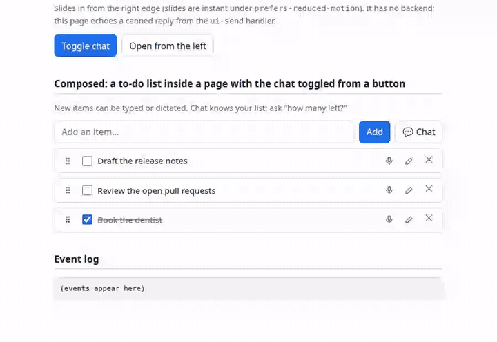
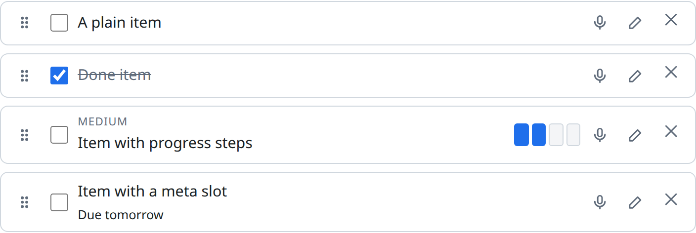
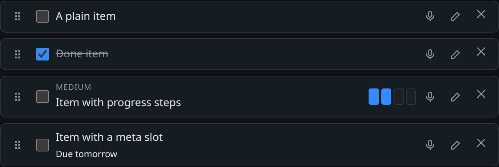
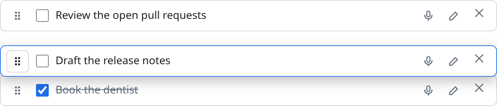
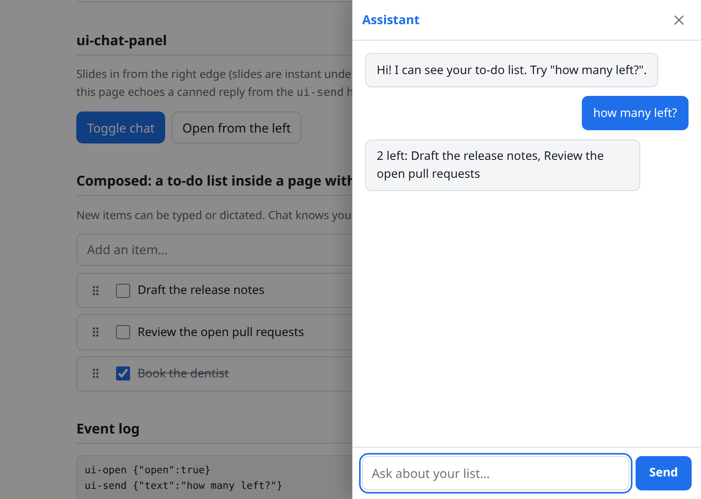

# ui-elements

A basket of small, composable, vanilla-JS custom elements that AI agents (and people) can discover and compose into generative UIs quickly.

- **No build step.** Plain ES modules, one component per file, no bundler, no npm install.
- **Themeable.** Shadow DOM plus CSS custom properties (`tokens.css`), light and dark.
- **Discoverable.** [`components.json`](components.json) is a machine-readable catalog of every tag, attribute, slot, event and CSS property.

## Use

```html
<script type="module" src="https://cdn.jsdelivr.net/gh/zevaverbach/ui-elements@v0.1.0/components/ui-todo-item.js"></script>
<ui-todo-item text="Buy milk"></ui-todo-item>
```

Optional theme tokens (components work without them):

```html
<link rel="stylesheet" href="https://cdn.jsdelivr.net/gh/zevaverbach/ui-elements@v0.1.0/tokens.css">
```



([MP4 version](docs/media/demo.mp4) of the same recording.) Try it live: https://zevaverbach.github.io/ui-elements/demo/

## Examples

### A reorderable to-do list

Put several `ui-todo-item`s under one parent; drag the grip, or focus it and press Space, Arrow keys, Space.




```html
<script type="module" src="https://cdn.jsdelivr.net/gh/zevaverbach/ui-elements@v0.1.0/components/ui-todo-item.js"></script>

<div id="list">
  <ui-todo-item text="Draft the release notes"></ui-todo-item>
  <ui-todo-item text="Medium task" label="Medium" progress="50"></ui-todo-item>
  <ui-todo-item text="Already done" checked></ui-todo-item>
</div>

<script>
  const list = document.getElementById('list');
  list.addEventListener('ui-toggle', (e) => console.log(e.target.text, e.detail.checked));
  list.addEventListener('ui-reorder', (e) => console.log('moved', e.detail.from, '->', e.detail.to));
  list.addEventListener('ui-transcript', (e) => e.detail.final && console.log('heard:', e.detail.text));
  list.addEventListener('ui-delete', (e) => { if (!confirmWithServer()) e.preventDefault(); }); // cancelable
</script>
```

Add an item from code: `list.prepend(Object.assign(document.createElement('ui-todo-item'), { text: 'New' }))`.



### A chat panel toggled from a button

`ui-chat-panel` has no backend. You listen for `ui-send` and add the replies yourself.



```html
<script type="module" src="https://cdn.jsdelivr.net/gh/zevaverbach/ui-elements@v0.1.0/components/ui-chat-panel.js"></script>

<button onclick="chat.toggle()">Chat</button>
<ui-chat-panel id="chat" heading="Assistant" backdrop>
  <div data-role="agent">Hi! Ask me anything.</div>
</ui-chat-panel>

<script>
  chat.addEventListener('ui-send', async (e) => {
    chat.busy = true;                                    // shows "Thinking…", disables Send
    const reply = await myBackend(e.detail.text);        // your fetch, websocket, LLM call…
    chat.busy = false;
    chat.addMessage('agent', reply);
  });
</script>
```

Use `side="left"` or `side="bottom"` to slide from another edge, or `chat.messages = [{ role: 'user', text: 'Hi' }]` to load history.

### Composing both, and theming

Wire the two together in plain JS, as [`demo/index.html`](demo/index.html) does (the chat answers "how many left?" by reading the list). Retheme everything with tokens, no component edits:

```css
:root { --ui-color-accent: #7c3aed; --ui-radius: 14px; }
ui-chat-panel { --ui-chat-panel-width: 24rem; }
```

## Components

| Tag | What it is |
|---|---|
| `ui-todo-item` | To-do item: check, inline edit, confirm-delete, progress steps, speech-to-text mic (Web Speech API), drag/keyboard/touch reorder |
| `ui-chat-panel` | Slide-in chat panel with `ui-send` event; no backend assumed |

Full API for each is in the file header and in `components.json`. Design provenance: [`docs/inventory.md`](docs/inventory.md).

## URLs

| What | URL |
|---|---|
| Component (pinned, preferred) | `https://cdn.jsdelivr.net/gh/zevaverbach/ui-elements@v0.1.0/components/ui-todo-item.js` (or `@<commit SHA>`) |
| Catalog | `https://cdn.jsdelivr.net/gh/zevaverbach/ui-elements@v0.1.0/components.json` |
| Tokens | `https://cdn.jsdelivr.net/gh/zevaverbach/ui-elements@v0.1.0/tokens.css` |
| GitHub Pages (only if enabled) | `https://zevaverbach.github.io/ui-elements/components/ui-todo-item.js`, live demo at `https://zevaverbach.github.io/ui-elements/demo/` |

`@main` URLs are cached by jsDelivr for hours; use a tag or a commit SHA for stability. Relative imports inside components (`./_shared/*.js`) resolve correctly when served from jsDelivr.

## Try the demo locally

ES modules do not load from `file://`; serve the repo root:

```sh
python3 -m http.server   # then open http://localhost:8000/demo/
```

## Regenerate the screenshots and video

```sh
python3 scripts/capture-media.py   # needs playwright + ffmpeg; see the file header
```

## Check the catalog

```sh
node scripts/check-catalog.mjs   # dev-only; the library itself needs no Node
```
