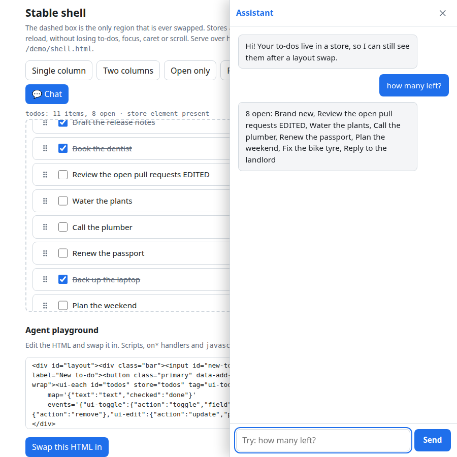

# State and the stable shell

Goal: an agent can change a page's UI at runtime, with no page reload and no build step, by swapping in HTML made of existing `ui-*` components. This only works if state lives outside the region that gets swapped.

Implemented by `<ui-store>`, `<ui-each>` and `swapOutlet()` (see [`specs/ui-store.md`](specs/ui-store.md)). Working example: [`demo/shell.html`](../demo/shell.html).



> Availability: these pieces are on `main` and ship with the next tag (suggested `v0.2.0`). Until it exists, pin a commit SHA in jsDelivr URLs.

## The model

- **Level 1 (the default).** The agent emits new HTML composed of existing `ui-*` tags, and the page replaces the contents of a single outlet element. No new JavaScript is loaded.
- **Level 2** (changing a component's code) is rare, happens at build time through this repo, and is out of scope here.

What level 1 can do: add, remove and rearrange components; change attributes, slotted content and theme tokens; wire components together through events and shared state; build new screens from the existing vocabulary.

What level 1 cannot do: add behavior that no component has; create new component types; change a component's internals; custom visuals beyond tokens and `::part()`; arbitrary logic. When one of these is needed, the right move is to request a new component (a change to this repo), not to hack around the limit with inline script.

## The problem

Swapping DOM destroys elements, and with them any state held inside those elements. Three kinds of state need three different answers.

1. **Data state** (to-do items, chat messages). Lives in a named store outside the swapped region (`<ui-store>`). Components read from it by name.
2. **Transient UI state** (focus, caret position, scroll position, half-typed text, open/closed panels). Survives only if the swap *morphs* the existing DOM instead of replacing it, and elements carry stable `id` attributes so the morph can match old and new elements. `swapOutlet()` uses [Idiomorph](https://github.com/bigskysoftware/idiomorph) (loaded from jsDelivr), and additionally restores typed text and scroll offsets (see Decisions in the spec).
3. **Persistent state** (survives a real page reload). A store with `persist="local"` (or `"session"`) writes itself to storage. Server sync can come later: listen for `ui-store-change`.

## The stable shell

Every page has a shell that the agent never swaps. It contains:

- the stores (`<ui-store>` elements);
- long-lived UI that carries conversation or session continuity (`<ui-chat-panel>`);
- exactly one outlet element (`<main id="outlet">`), which is the only region the agent may replace.

```html
<ui-store name="todos" persist="local"></ui-store>
<ui-chat-panel id="chat" store="chat"></ui-chat-panel>
<main id="outlet"> ...agent-written ui-* HTML... </main>
<script type="module">
  import { swapOutlet } from '.../components/_shared/outlet.js';
  await swapOutlet(agentHtml);           // sanitize, then morph only #outlet
</script>
```

Rules:

1. Only the outlet's contents are replaced, and always through `swapOutlet()`, never through ad hoc `innerHTML` elsewhere.
2. Stores are declared in the shell. A `<ui-store>` that ends up inside the outlet still works: data lives in a module-level registry keyed by store name, and the element is only a handle, so data survives the element being removed and re-added.
3. Swapped HTML is untrusted. Before insertion, `<script>` elements, inline event-handler attributes (`on*`) and `javascript:` URLs are stripped (plus iframe/object/embed/style/link/meta/svg/math/form, and `data:` URLs other than small images). Only `ui-*` tags listed in `components.json` and ordinary layout/text tags are allowed. The one exception to "no script" is inert `<script type="application/json">` directly inside `<ui-store>`, which is data.
4. Give every component instance that holds transient state a stable `id`, and keep those ids stable across successive agent outputs so the morph keeps them. Give every `<ui-each>` a stable `id`.
5. When a component is bound to a store (`store` attribute), it renders from the store and sends changes back as actions (`ui-action`). It must not keep authoritative data in its own fields.
6. Store binding is additive. Every existing component keeps working standalone, exactly as before.

## Decision rules for the agent

- Needs a new screen or layout: swap the outlet.
- Needs data to survive swaps: put it in a store.
- Needs a behavior no component offers: stop and propose a new component in the repo; do not inline script.

## Writing swap-friendly HTML

```html
<div id="layout">
  <input id="new-todo" type="text" placeholder="Add…">          <!-- stable id: focus, caret, text survive -->
  <ui-each id="todos" store="todos" tag="ui-todo-item" where='{"done":false}'
           map='{"text":"text","checked":"done"}'
           events='{"ui-toggle":{"action":"toggle","field":"done"},
                    "ui-reorder":{"action":"move"},
                    "ui-delete":{"action":"remove"},
                    "ui-edit":{"action":"update","patch":{"text":"$detail.text"}}}'></ui-each>
</div>
```

Keep `ui-each` ids the same across layouts when you want its rows to keep their instances (and any open edit/focus); change `where` or surrounding markup freely. A new id means new rows (data is still safe).

Behavior that swapped HTML cannot contain (for example "pressing Enter in this input adds a to-do") belongs to the shell or to a new component. The demo wires its add field in the shell script; a declarative action-trigger component would be the clean fix (see Follow-ups).
