# Tests

A real-browser test suite for the components, the state/shell features, the sanitizer, the CDN consumption path and agent-composed pages. Every browser test is **recorded as an animated GIF with on-screen step captions**; every failure writes a **failure bundle** that people and agents can read.

Dev-only: nothing here is loaded by consumers, and the library itself stays build-free. The tooling is Python + Playwright + ffmpeg (the same stack as `scripts/capture-media.py`); Node (>= 18, no packages) runs the catalog check. There is no `package.json` and no npm install.

## Run

```sh
pip install playwright && playwright install chromium     # once; ffmpeg and node must be on PATH
python3 tests/run.py                                       # everything, headless  (about 80 s)
```

| Command | What it does |
|---|---|
| `python3 tests/run.py --suite todo-item` | one suite (repeatable) |
| `python3 tests/run.py -k reorder` | tests whose name contains the text |
| `python3 tests/run.py --list` | list tests (`[online]` marks the ones that need the internet) |
| `python3 tests/run.py --gifs` | also (re)write `tests/media/<suite>-<test>.gif` for **passing** tests |
| `python3 tests/run.py --headed --slow` | watch the browser |
| `python3 tests/run.py --no-online` | skip the checks that need the internet |
| `python3 tests/run.py --table` | print the recordings table below (paste into this README) |
| `node scripts/check-catalog.mjs` | suite A alone (no browser) |
| `python3 tests/agent-evals/run_evals.py --outputs DIR` | score a folder of agent outputs ([details](agent-evals/README.md)) |

Exit code is 1 if any test fails. Tests are headless and offline: all requests that leave localhost are blocked, except the two clearly marked online checks (`consume-online-real-jsdelivr`, `visual-axe-accessibility`), which skip themselves when offline. The pinned [Idiomorph](https://github.com/bigskysoftware/idiomorph) build that `swapOutlet` imports is fetched once into `tests/.cache/` (gitignored) and served to the pages from there; without the cache and without internet the shell tests report "skipped" with that reason.

## Suites

| Suite | Checks | Why |
|---|---|---|
| **A. catalog** (`catalog-integrity`) | `components.json` parses; every component file has an entry, a header and a demo; every attribute, event, slot, method, property, part, CSS custom property and store action in the **source** matches the catalog and the file header, in both directions, with a diff when they disagree | agents trust the catalog instead of reading source; drift makes them write wrong HTML |
| **B. `todo-item`, `chat-panel`** | attributes and properties, event names and `detail` shapes (and that they bubble and are composed), keyboard behavior, roles/labels/focus order. todo-item: toggle, progress steps, inline edit, confirm-delete including a vetoed cancelable `ui-delete`, mouse drag, keyboard and **touch** reorder, speech-to-text with a **mocked SpeechRecognition** (and the mic hidden when the API is missing). chat-panel: open/close, focus return, backdrop, all three sides, `ui-send` (cancelable, Shift+Enter), `addMessage`/`messages`, busy, `prefers-reduced-motion`, store binding | the contract of each element, in a real browser |
| **C. `state`** | on `demo/shell.html`: swapping the outlet keeps the to-do items, **focus and caret** in an input with a stable id, typed text, scroll position and an open inline edit; removing and re-adding `<ui-store>` keeps data; `persist="local"` survives reload (and a schema version bump re-seeds); a `ui-action` from inside the outlet reaches a store in the shell; filtered views; chat history | the point of the stable shell |
| **D. `sanitizer`** | 51 table-driven cases (script/iframe/object/embed, `on*` in every spelling, `javascript:` URLs with case/whitespace/entity tricks, nested and malformed markup, mXSS patterns) run through `sanitizeHtml`, then **inserted into a live page** to prove nothing executes; `ui-*` and layout tags survive; output is idempotent | swapped HTML is untrusted |
| **E. `consume`** | a blank page on one origin imports components from a second origin that mimics the jsDelivr layout (`/gh/<user>/<repo>@<ref>/<path>`, CORS): relative `./_shared/*.js` imports work, every catalog module loads, `swapOutlet` finds `components.json` relative to itself; plus one online check against real jsDelivr (skips when offline or the tag does not exist) | proves the no-build, CDN-only promise |
| **F. `agent-evals`** | tasks, golden solutions and a checker (tags, attributes, script rules, wiring, console errors, task assertions). The goldens must pass; 23 kinds of bad output must be rejected with the right code, including inline script on the one task no component can do, where the right answer is a written request for a new component | lets you measure agents without an LLM in the repo; see [agent-evals/README.md](agent-evals/README.md) |
| **G. `visual`, `demo-pages`** | light/dark screenshots of every demo page (only the dark pass is recorded) (background luminance, no horizontal overflow, non-blank, light != dark), an axe-core pass (online), and the framework-free assertion pages `demo/sanitizer-test.html` and `demo/store-test.html` | catches theming and accessibility regressions |

## Recordings

Every recording is made in **dark mode** (the browser context uses `color_scheme="dark"`; the visual test checks light mode in a separate, unrecorded context). Each recording is the test's own run: the caption at the bottom is the current step, the red dot is the pointer, the badge in the corner is the key being pressed. Only **passing** runs are kept.

#### agent-evals

<details><summary>8 tests</summary>

| Test | What it checks | Recording |
|---|---|---|
| `golden-shopping-list` | The reference page for the shopping-list task (two filtered views of one store plus a chat panel) passes the checker: only catalog tags, no script, stores and lists wired correctly, and the task's own browser assertions hold. | 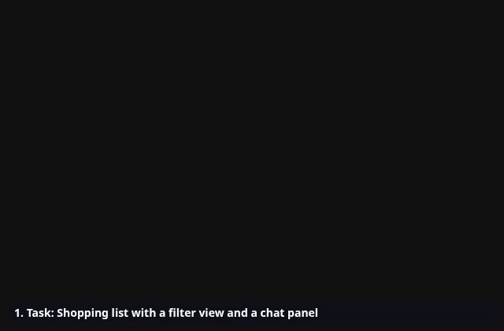 |
| `golden-todo-progress` | The reference page for the release-checklist task (three to-dos with progress steps, no store) passes the checker and its browser assertions. | 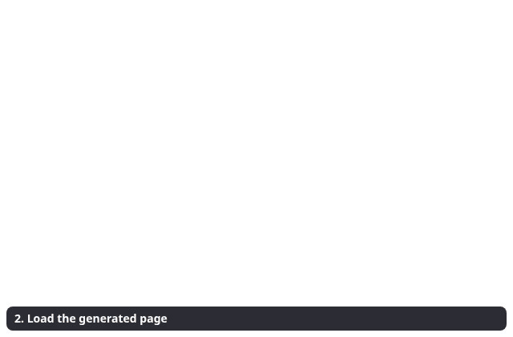 |
| `golden-chat-left` | The reference page for the support-chat task (a chat panel that opens from the left with a placeholder and a first message) passes the checker and its browser assertions. | 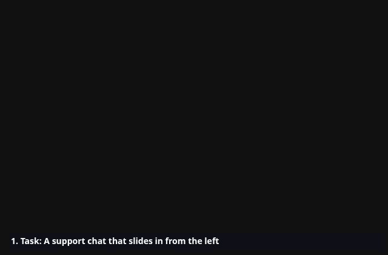 |
| `golden-kanban` | The reference page for the three-column board task (filtered views of one store, with confirm-to-delete) passes the checker and its browser assertions. | 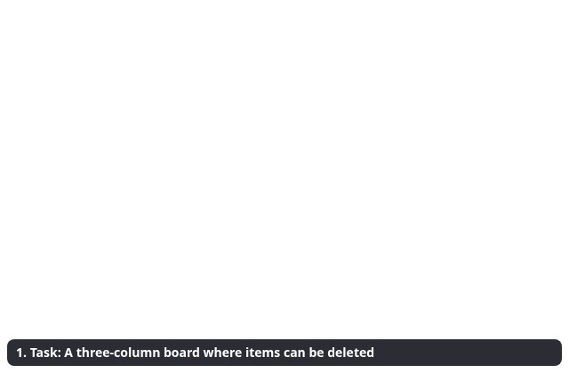 |
| `golden-needs-new-behavior-is-a-request` | For a task no component can do (a countdown timer), the correct answer is a written request for a new component with no inline script, and the checker accepts it. | 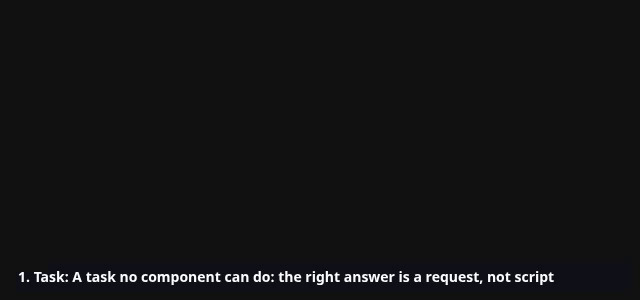 |
| `checker-rejects-bad-output` | Each of a set of deliberately broken pages (unknown tags, script, on* handlers, broken wiring, missing ids and so on) is rejected by the checker with the right reason. |  |
| `checker-rejects-cheating-on-the-impossible-task` | Answering the impossible task with inline script or other workarounds is rejected; only a proper component request passes. | 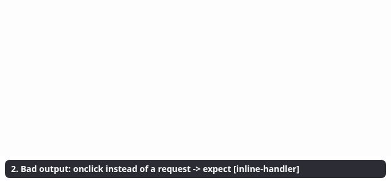 |
| `cli-and-aggregate-scoring` | check.py works as a command-line tool, and run_evals.py scores a folder of outputs and aggregates success rate and iterations. | (no GIF) |

</details>

#### chat-panel

<details><summary>9 tests</summary>

| Test | What it checks | Recording |
|---|---|---|
| `open-close` | A closed panel is off screen, hidden and inert; toggle() opens it and returns the new state, focuses the composer, and Escape closes it and returns focus to the opener. | 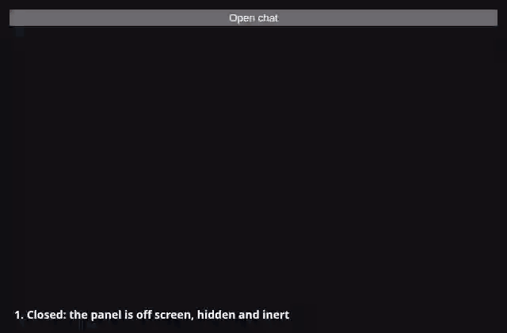 |
| `backdrop` | The `backdrop` attribute shows a scrim while the panel is open, and clicking the scrim closes the panel. | 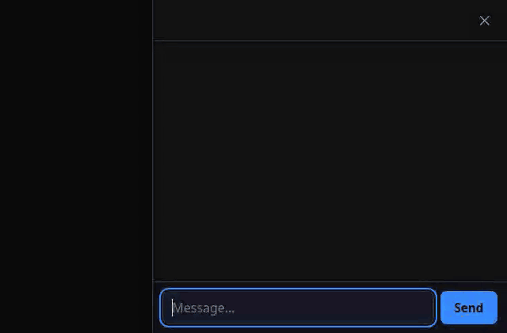 |
| `sides` | The `side` attribute puts the panel on the right (default), left or bottom edge and slides it in from there. |  |
| `send-and-messages` | Slotted messages render by role; Enter sends, Shift+Enter inserts a newline, empty input sends nothing, and a ui-send event carries the text. | 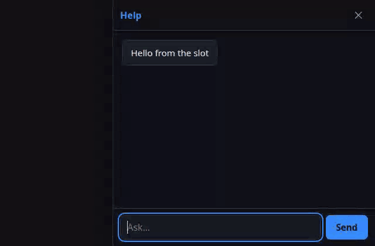 |
| `busy-and-no-echo` | `no-echo` stops the user bubble being added on send; `busy` shows a pending bubble and disables Send, `busy-text` customizes it, and clearing `busy` re-enables Send. | 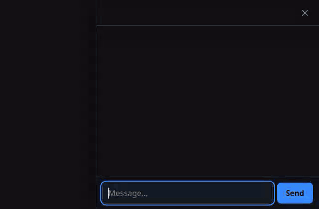 |
| `reduced-motion` | With prefers-reduced-motion: reduce the panel slides with no real duration and is fully on screen immediately after opening. | 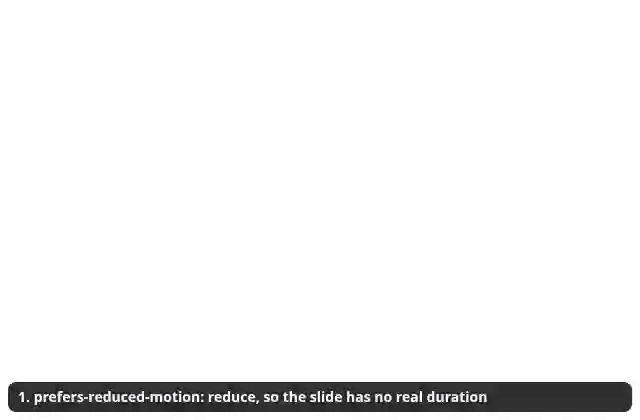 |
| `slide-animation` | Without a reduced-motion preference the panel animates in about 250 ms, and --ui-chat-panel-duration changes the speed. | 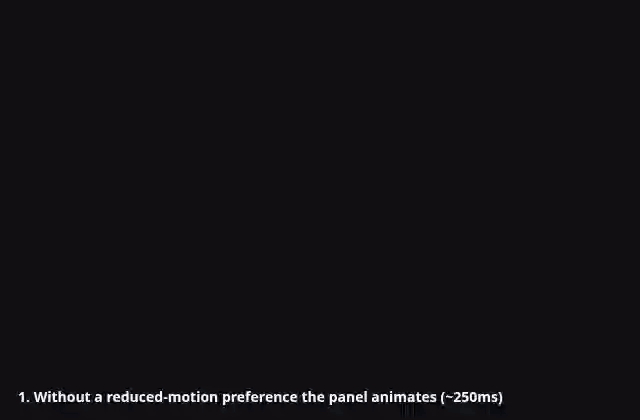 |
| `accessibility` | The panel has proper roles and labels; while closed Tab skips it entirely, and when open the tab order is close, message log, composer, send. | 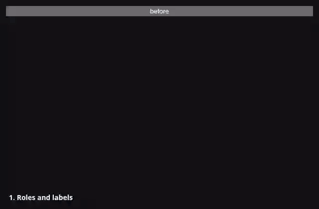 |
| `store-binding` | With the `store` attribute, messages render from the store, sending dispatches a ui-action instead of echoing, and a store change from elsewhere appears in the panel. | 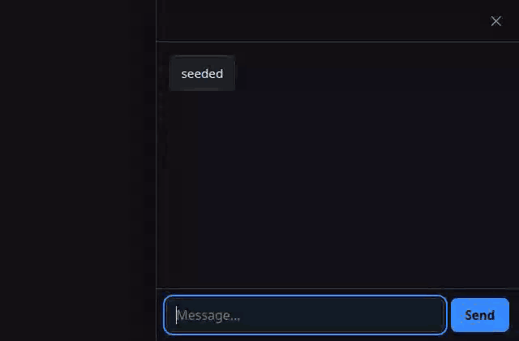 |

</details>

#### consume

<details><summary>4 tests</summary>

| Test | What it checks | Recording |
|---|---|---|
| `cdn-layout-and-relative-imports` | A blank page imports components from a jsDelivr-shaped URL: both elements define and render, the relative ./_shared imports resolve from the same path, and the component works. | 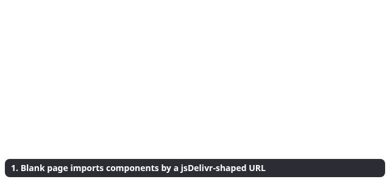 |
| `catalog-matches-loaded-modules` | components.json fetched from the CDN-style path lists modules that all load, and every catalog tag ends up defined. | 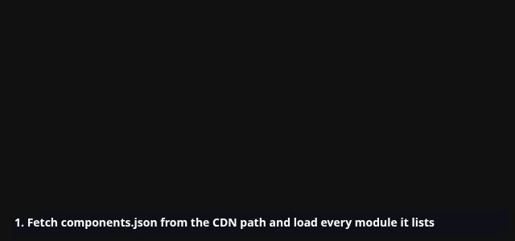 |
| `swap-outlet-from-the-cdn-path` | swapOutlet imported from the CDN-style path swaps an outlet correctly. | 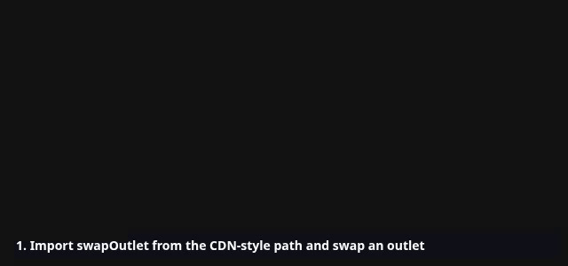 |
| `online-real-jsdelivr` (online) | Online check against the real jsDelivr: the pinned tag serves the module and its _shared imports. | 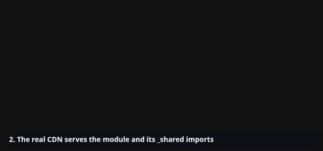 |

</details>

#### demo-pages

<details><summary>5 tests</summary>

| Test | What it checks | Recording |
|---|---|---|
| `sanitizer-assertions` | Opens demo/sanitizer-test.html and requires all 36 of its in-page sanitizer assertions to pass with no console errors. | 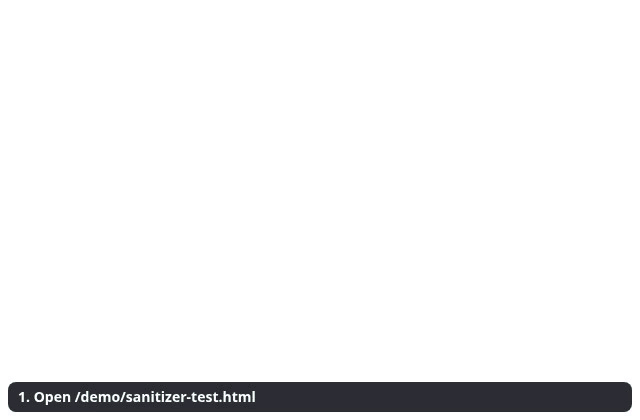 |
| `store-assertions` | Opens demo/store-test.html and requires all 42 of its in-page store assertions to pass. | 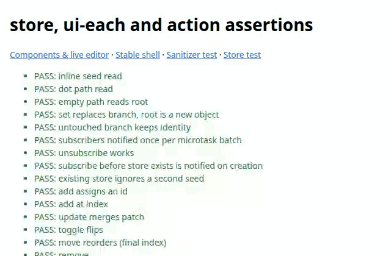 |
| `reset-data-restores-the-seed` | Regression test: "Reset data" on the live editor puts back exactly the four seed to-dos (it used to drop one), whether or not anything was changed. | 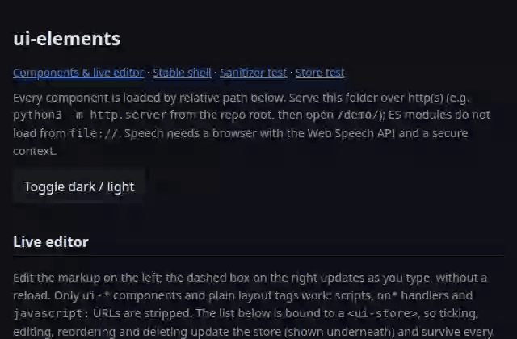 |
| `injection-example-shows-what-was-removed` | The "Try to inject script" example lists exactly what the sanitizer removed (script, onclick, onerror, javascript: URL), the preview really is clean, and the ui-* component survives. | 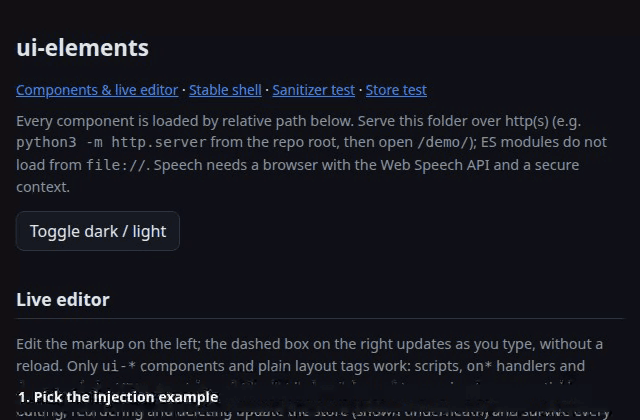 |
| `layouts-use-the-width-on-tablets` | On iPad-sized screens the demo pages fill the width (no narrow centered column), the two-column to-do layout is used only when wide enough to read, and stacks on iPad portrait. | 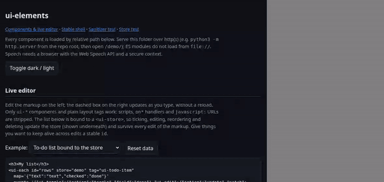 |

</details>

#### sanitizer

<details><summary>2 tests</summary>

| Test | What it checks | Recording |
|---|---|---|
| `table-driven` | A table of 51 markup cases: dangerous markup is removed, ui-* and layout tags are kept, and each case also inserted into a live page runs nothing. | 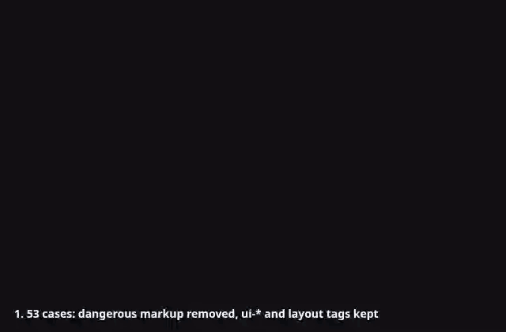 |
| `allowlist-comes-from-the-catalog` | swapOutlet allows only the tags listed in components.json, and rejects a missing outlet with a clear error. | 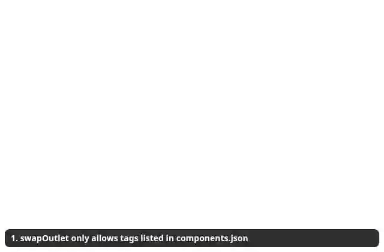 |

</details>

#### state

<details><summary>10 tests</summary>

| Test | What it checks | Recording |
|---|---|---|
| `swap-keeps-focus-caret-and-text` | Swapping the outlet keeps focus, the caret and half-typed text in a stable-id input, and no to-dos are lost. | 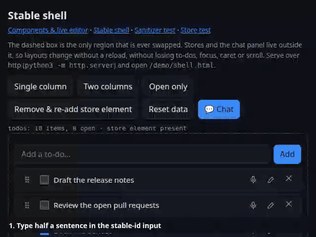 |
| `swap-keeps-scroll-position` | Swapping the outlet keeps its scroll position, even when new markup is added above the list. | 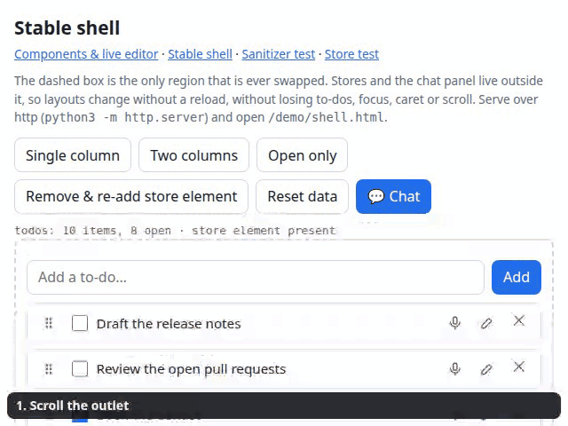 |
| `swap-keeps-component-instances` | A swap morphs rather than replaces: the same element instance survives with its inline edit still open, and finishing the edit lands in the store. |  |
| `filtered-view-and-two-columns` | Layouts built from one store: an open-only view, and two columns (open and done) where ticking an item moves it across. | 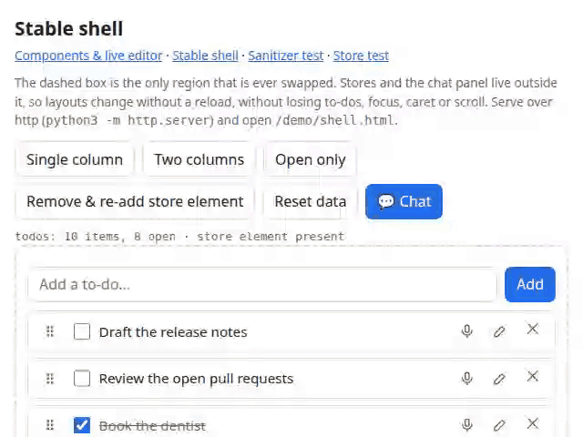 |
| `action-from-outlet-reaches-shell-store` | The store lives in the shell outside #outlet; ticking, renaming and deleting a row inside the outlet reach it through ui-action events. |  |
| `add-and-reorder-update-the-store` | Adding a to-do through the shell's input and reordering with the keyboard both update the store. | 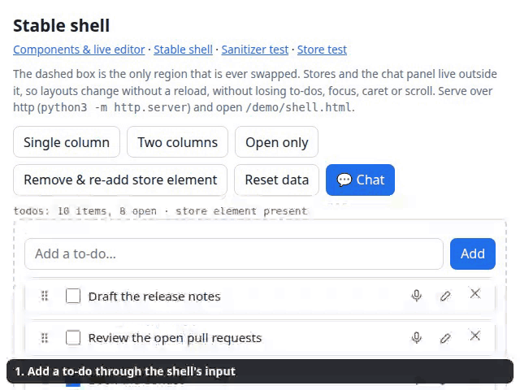 |
| `store-element-remove-and-readd` | Removing the <ui-store> element keeps the data, which is still rendered; changes made while it is gone survive re-adding it. | 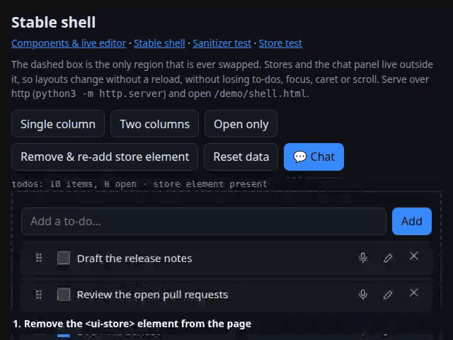 |
| `persist-local-survives-reload` | With persist="local" changes survive a reload (items, order, ticked state), and a different schema version ignores stored data and re-seeds. |  |
| `chat-panel-in-the-shell` | The shell's chat panel and its conversation survive an outlet swap and a page reload. | 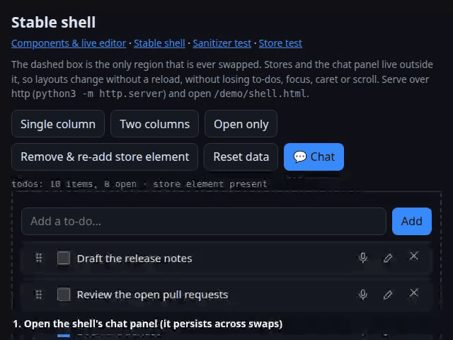 |
| `outlet-never-swaps-the-shell` | Hostile markup swapped into the outlet never touches the shell: the chat panel and store elements are untouched. | 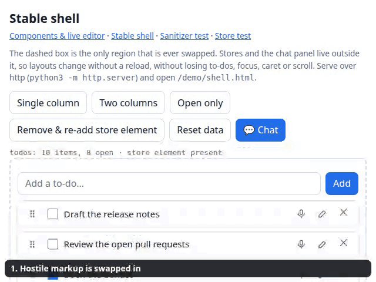 |

</details>

#### todo-item

<details><summary>13 tests</summary>

| Test | What it checks | Recording |
|---|---|---|
| `attributes-and-properties` | Attributes and properties stay in sync: `text`, `checked`, `label` (eyebrow), `progress` (steps) and the `editing` attribute. | 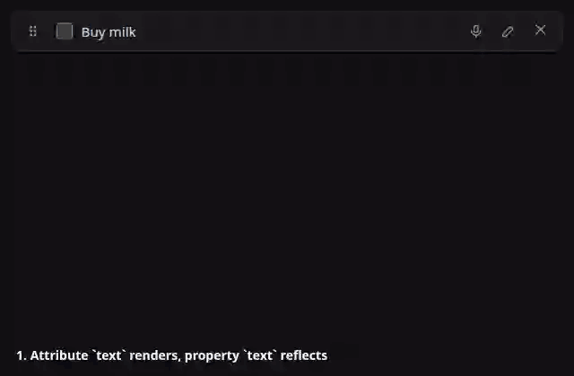 |
| `toggle` | Ticking the checkbox strikes the text through and emits ui-toggle; unticking reverses it. | 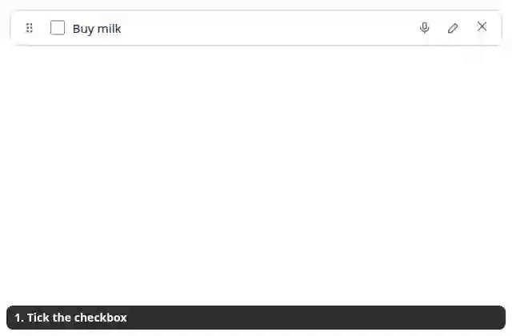 |
| `progress-steps` | Clicking progress steps sets the progress; clicking the active step steps back, 100% completes the item, and unticking restores the previous progress. | 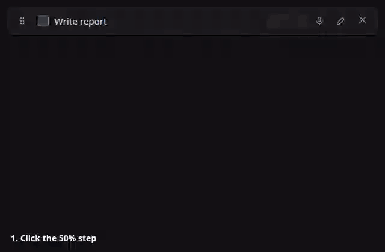 |
| `inline-edit` | Double-clicking the text edits it: Enter saves, Escape cancels, and an empty value is not saved. | 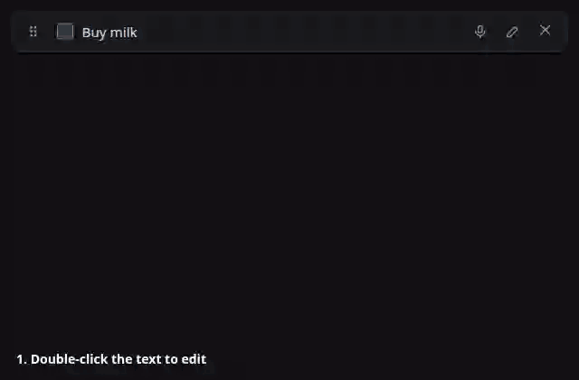 |
| `edit-field-is-focused-immediately` | Regression test: the edit field is focused in the same task as startEdit(), so keystrokes typed right after clicking Edit are not lost. | 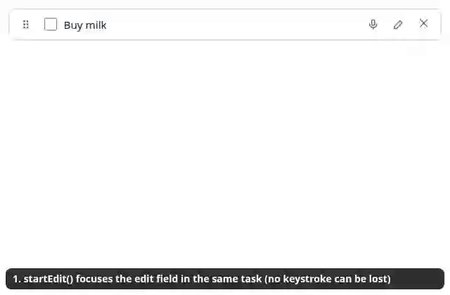 |
| `confirm-delete` | Delete takes two clicks (the first arms it and expires on its own), a vetoed ui-delete keeps the item, and a confirmed one removes it. | 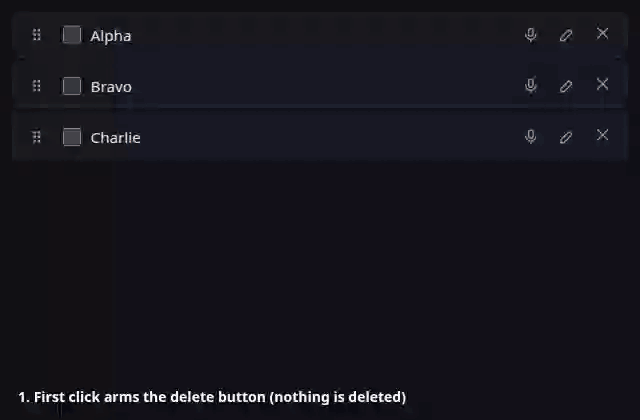 |
| `drag-reorder` | Dragging an item's grip with the mouse reorders the list and emits ui-reorder. | 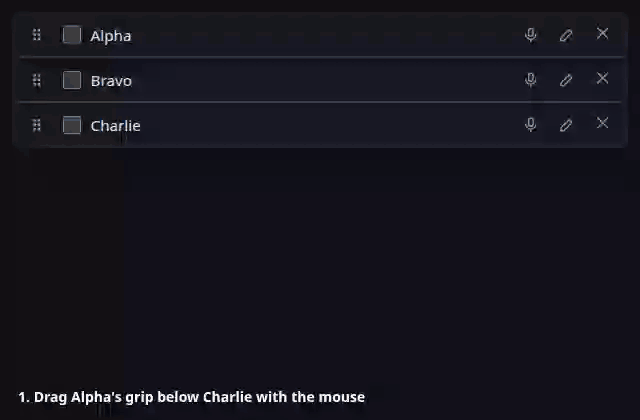 |
| `keyboard-reorder` | Space grabs an item's grip, arrows move it, Space drops it and Escape cancels the grab. | 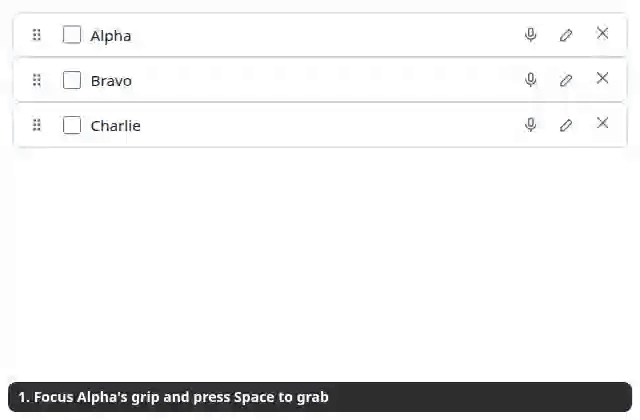 |
| `touch-reorder` | Touch-dragging the grip reorders items (simulated touch events), and the grip opts out of touch scrolling. | 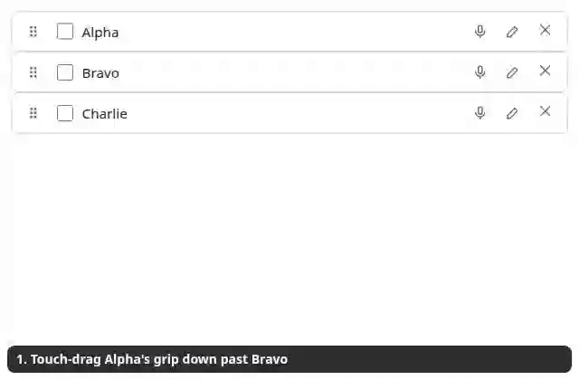 |
| `speech-to-text` | With a mocked Web Speech API, the mic opens edit mode and starts listening; interim results emit ui-transcript without changing the field, and final results are appended. | 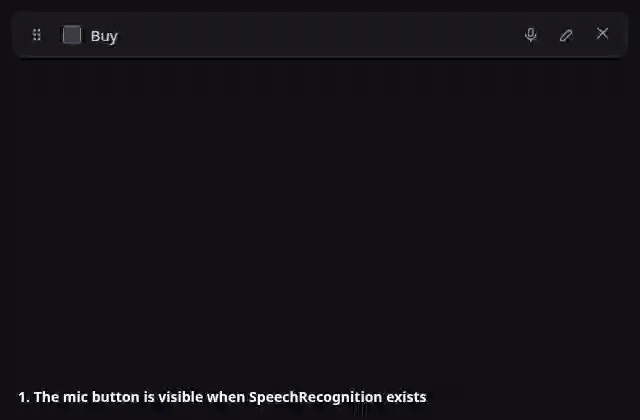 |
| `speech-unsupported` | Without the Web Speech API the mic button is hidden and the rest of the item still works. | 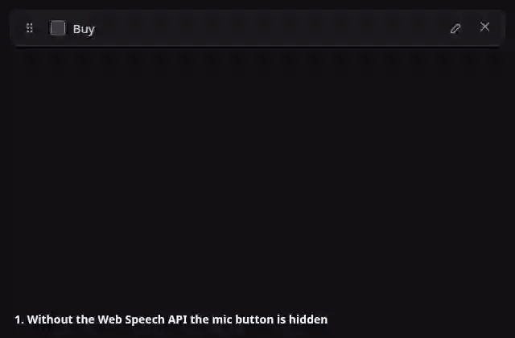 |
| `speech-opt-out` | The `no-speech` attribute hides the mic even when the API exists. | 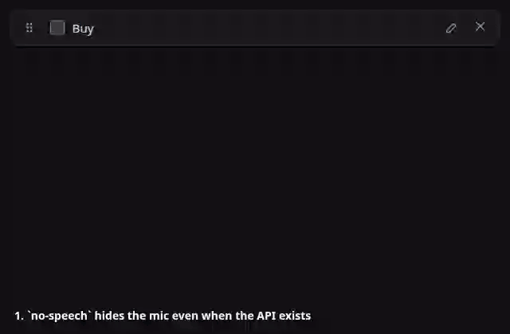 |
| `accessibility` | Every control has an accessible name, and the Tab order is grip, checkbox, steps, mic, edit, delete. | 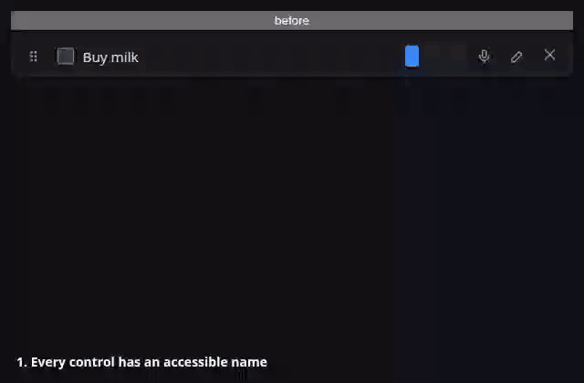 |

</details>

#### visual

<details><summary>2 tests</summary>

| Test | What it checks | Recording |
|---|---|---|
| `demo-pages-light-and-dark` | Every demo page renders in both color schemes with no horizontal overflow, no blank screenshot, and a clearly light and a clearly dark background (the recording shows the dark pass). | 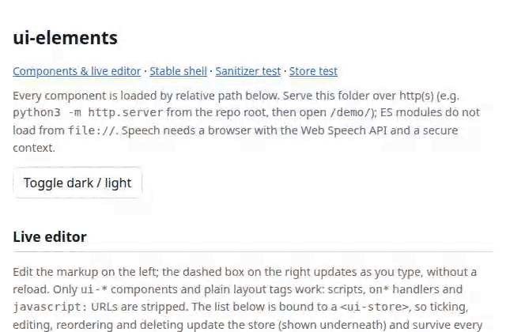 |
| `axe-accessibility` (online) | Online check: axe-core finds no serious or critical accessibility violations on the demo pages. | 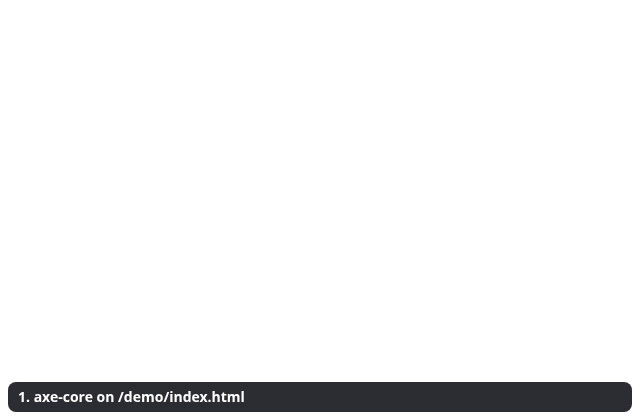 |

</details>

Regenerate: `python3 tests/run.py --gifs` (about 5 minutes), then `python3 tests/run.py --table` and paste. The "What it checks" text comes from the `desc=` argument of each `@test(...)`; give every new test one. A failing test never overwrites its committed GIF. GIFs are produced with ffmpeg's two-pass `palettegen`/`paletteuse`, about 8 fps (the ladder steps down from there), at most 640 px wide, from the first caption to just after the last (idle time trimmed, 18 s cap).

**Media budget:** each GIF under 1.5 MB and `tests/media/` under 15 MB in total. `kit/video_to_gif.py` steps down fps, width and palette size until a GIF fits and refuses to write one that does not; `run.py` fails the run if the folder goes over 15 MB. Currently: 14.6 MB in 52 GIFs, largest 1232 KB. Headroom is thin (about 0.4 MB): trim or shorten a recording before adding many more.

## Failure bundles

A failing test writes `tests/failures/<suite>-<test>/` (gitignored; CI uploads it as an artifact):

| File | For | Contents |
|---|---|---|
| `failure.gif` | people | the run as an animation |
| `filmstrip.png` | agents | contact sheet of ~8 labelled key frames, including the last |
| `report.json` | agents | test name, **failing step**, error + traceback, console errors, page URL, the **catalog entry** of the component under test, a trimmed shadow-DOM-aware **DOM snapshot** around the failing element, all steps |
| `console.log` | both | every console message and page error with timestamps |

Uncaught page errors and unexpected `console.error`s fail a test (a test can declare expected ones with `t.allow_console(...)`). The loop for a person or an agent: run, read `report.json` and `filmstrip.png`, fix, rerun. More in [docs/testing-your-app.md](../docs/testing-your-app.md).

## Reuse the pattern in your own project

[`tests/kit/`](kit/README.md) is a copy-paste kit (caption helper, video-to-GIF, filmstrip, failure-bundle writer, harness, a sample test) that depends on nothing in this repo. This repo's runner is built on it, so it is exercised on every run. [docs/testing-your-app.md](../docs/testing-your-app.md) explains the pattern. [`ci/tests.yml`](ci/tests.yml) is the GitHub Actions workflow (also installed at `.github/workflows/tests.yml`).

## Layout

```
tests/
  run.py            runner (servers, discovery, recording, summary)
  registry.py       @test decorator, shared env, mocks (SpeechRecognition), fixture helpers
  helpers.py        focus path, rects, touch drag
  server.py         tiny static server (+ jsDelivr-style layout and in-memory pages)
  pages/fixture.html  blank page that loads every component
  suites/           the suites above
  agent-evals/      tasks, golden solutions, checker, scoring
  kit/              the reusable pieces
  ci/tests.yml      CI workflow (copy of .github/workflows/tests.yml)
  media/            committed GIFs (budgeted)     failures/ .cache/ screenshots/  (gitignored)
```

## Known issues and pending

No failing or pending tests. Bugs the suite found while it was being written, each fixed in its own commit with the test that exposed it:

1. **Sanitizer** (`outlet.js`): the parser's internal *is value* survived `removeAttribute('is')`, so `<div is="x">` was still serialized with `is="x"`. Elements carrying `is` are now rebuilt without it. Test: `sanitizer-table-driven`.
2. **Shell demo**: the playground `<textarea>` had `width: 100%` without `box-sizing: border-box` and overflowed the page by 10 px. Test: `visual-demo-pages-light-and-dark`.
3. **Demo page**: the scrollable store-data `<pre>` was not keyboard-focusable (axe `scrollable-region-focusable`, serious). Test: `visual-axe-accessibility`.
4. **`ui-todo-item`**: `startEdit()` focused the edit field in a `requestAnimationFrame`, so keys typed right after clicking Edit could be lost. Test: `todo-item-edit-field-is-focused-immediately`.

Not covered: browsers other than Chromium, real touch hardware and real speech recognition (mocked), and screen-reader output (only roles, labels, focus order and axe).

## Decisions

1. **Tooling: Python Playwright and a stdlib runner, no npm.** The repo already uses Python Playwright and ffmpeg (`scripts/capture-media.py`), both are installed, and they work offline. `@playwright/test` would have meant a `tests/package.json` plus a network install, so it was not added. Node is only used for the existing, dependency-free `scripts/check-catalog.mjs`. There is no pytest either: `run.py` is about 150 lines.
2. **The runner is built on the kit.** `tests/kit/` (caption, GIF, filmstrip, failure bundle, harness) is what `run.py` calls, so the copy-paste kit is exercised on every run. It imports nothing from this repo.
3. **Suite A extends `scripts/check-catalog.mjs`** instead of adding a sibling: the same script now also parses the source (attributes, events, slots, methods, properties, parts, CSS custom properties, store actions) and diffs it against the catalog and the file headers in both directions. Verified by mutation (added an attribute and an event to source, a phantom attribute to the catalog: all reported). `run.py` runs it as `catalog-integrity`.
4. **Offline by default.** Every request that leaves localhost is aborted by a Playwright route. Idiomorph (loaded from jsDelivr by `outlet.js`) is fetched once into `tests/.cache/` and served from there; with neither cache nor internet the shell tests are *skipped with a reason*, not failed. `--no-online` only skips the online checks; it does not stop that one-time fetch.
5. **Two online checks, both auto-skipping.** `consume-online-real-jsdelivr` (tag from `UI_ELEMENTS_TAG`, default `v0.1.0`; skips on HTTP 404 so it does not fail before a tag exists) and `visual-axe-accessibility`. The brief asks for axe-core to be loaded from a CDN, which makes it online too; it is clearly marked and skips offline.
6. **GIFs only with `--gifs`.** Videos are always recorded (a failure needs them) but GIFs are not rewritten on every run: it is slower (a readable on-screen dwell per step) and would churn committed binaries. A failing test never touches its committed GIF; a GIF that cannot fit the budget fails the test instead of being written.
7. **Budget.** Per-GIF limit 1.5 MB, total 15 MB, enforced by `video_to_gif` (steps down fps, width and palette) and by `run.py`. Viewports are small (640x420 to 640x480); GIFs start at the first caption and end just after the last.
8. **Sanitizer is one recorded test with 51 table rows**, not 51 GIFs. Each row is also inserted into a live page to prove nothing executes (payloads set `window.__pwned`), and checked for idempotence.
9. **Consumption uses two servers.** The consumer page is on one port; the library comes from a second port that answers `/gh/<user>/<repo>@<ref>/<path>` with CORS, like jsDelivr. The page is served by the real server, not by a Playwright route: Chromium's private-network-access check blocks a route-fulfilled page from reaching a second loopback origin.
10. **Touch reorder uses Chrome DevTools Protocol touch events** (`Input.dispatchTouchEvent`); Playwright's own touchscreen API only taps.
11. **Visual checks have no pixel baselines.** Baselines are brittle across fonts and OSes. Instead: background luminance for light/dark on the themed pages, no horizontal overflow, non-blank, light differs from dark. Screenshots go to `tests/screenshots/` (gitignored). The two assertion pages are plain unthemed pages, so they only get the overflow and blank checks.
12. **Console errors fail tests.** Uncaught page errors and `console.error` fail the test unless the test lists them with `t.allow_console(...)` (for example the deliberate 404 in the store test).
13. **Agent evals are stricter than the sanitizer.** The checker rejects any inline `<script>` anywhere in a generated page (not just in the outlet), allows `<style>` only outside the outlet, and requires the shell layout (`<main id="outlet">`, stores and chat outside it) for shell tasks. Goldens import from `@main` jsDelivr URLs; the checker serves them from the local checkout. The "needs new behavior" task is a `request` task: the correct output is a markdown request for a new `ui-*` component, checked for a new tag, attributes, events, the missing capability and why existing components are not enough.
14. **CI runs on pull requests and on pushes to `main`** (so on merges), from `.github/workflows/tests.yml`; `tests/ci/tests.yml` is a copy for people reusing the setup. It runs the offline suites, then the online checks (real jsDelivr, axe) in a second job, and uploads `tests/failures/` on failure. Pushes to other branches do not trigger it, so a PR run is not duplicated by a branch-push run.
15. **Failure bundles live in `tests/failures/<suite>-<test>/`** and are gitignored; `report.json` embeds the catalog entry of the component under test (`@test(..., component="ui-todo-item")`) and a DOM snapshot that pierces shadow roots.
